<p align="center">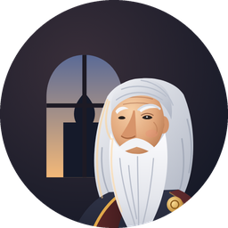</p>

<h1 align="center">Мудрец — расписание НовГУ</h1>

<p align="center"><b>Мудрый выбор на каждый день</b></p>

<p align="center"><i>«Доброе утро! Чай — и в путь за знаниями.»</i></p>

<p align="center">Пары НовГУ и его колледжей на телефоне и часах. Мудрец подскажет, какая пара сейчас,
куда идти дальше и когда вставать. Бесплатно, без рекламы и регистрации.</p>

<p align="center">
  <a href="https://github.com/BocmenDen/wiseman-releases/releases/latest"></a>
  <a href="#установка"></a>
</p>

## Что умеет Мудрец

**Сейчас и далее.** *«Хорошая концентрация сегодня. Ученье — свет!»*
Какая пара идёт, сколько до конца и где следующая — в карточке дня, рядом с Ярославом Мудрым.

**Где аудитория.** *«Пора в дорогу — первая пара скоро.»*
У аудитории видно здание и этаж: «1216 · Антоново · Старый корпус · 2 этаж». Если следующая пара
в другом здании, Мудрец предупредит прямо в перерыве: «в другой корпус: Антоново → Главный корпус».

**Любое расписание.** Своя и чужая группа, преподаватель, аудитория или студент — всё через поиск.
Институты НовГУ и колледжи: Политехнический, Медицинский, Старорусский политехнический.
Отметьте своё звёздочкой — «Моё» откроется сразу, а подгруппа живёт в шапке рядом с группой.

**Замены и отмены.** Перенос, отмена, другая аудитория — пометка в карточке и уведомление
понятным текстом, без расшифровки портала.

**Будильник перед первой парой.** *«Пора вставать.»*
Заводится сам по «Моё», по умолчанию за полтора часа, и называет первую пару. Включите погоду —
и Мудрец добавит совет: *«Возьми зонт»*, *«Оденься теплее»* или *«Погода спокойная — в добрый путь»*.
Пары отменили — будильник промолчит.

**Карта корпуса (Beta).** Этажи в 2D и 3D, свободные и занятые аудитории сейчас или к нужному времени,
маршрут от входа — можно без лестниц.

**Часы Wear OS.** Пара сейчас, плитки, усложнения, будильник вместе с телефоном. Новые версии
телефон сам отправляет на часы — останется подтвердить.

**Без сети тоже.** Сохранённое расписание открывается офлайн. *«Спокойной ночи. Мудрость любит сон.»*

## Почему «Мудрец»

- **Расписание, а не таблица с портала.** Мы чистим и связываем данные: у аудитории — здание и адрес,
  у преподавателя — должность и контакты, если они открыты, у группы — курс и направление.
- **Немного магии ИИ.** Опечатки и разные написания аудиторий и имён сводим к одному виду —
  правилами и с помощью ИИ.
- **Свой сервер.** Данные приходят с нашего сервера, а не напрямую с портала: быстрее и работает,
  даже когда портал тормозит. В «О приложении» видно, когда что обновлялось.

## Установка

**Телефон.** Из RuStore (ссылка появится после публикации) или файлом `wiseman-phone-<версия>.apk` из
[последнего выпуска](https://github.com/BocmenDen/wiseman-releases/releases/latest): откройте файл на телефоне
и разрешите установку из этого источника. Android 8 и новее.

**Часы.** Первый раз — файлом `wiseman-watch-<версия>.apk` по Wi-Fi,
[пошаговая инструкция](docs/watch.md). Дальше обновления приходят через телефон. Wear OS 3 и новее.

**Проверка файла.** В каждом выпуске есть `SHA256SUMS.txt`:

```bash
sha256sum -c SHA256SUMS.txt
```

## Скриншоты

| | | |
|:-:|:-:|:-:|
| 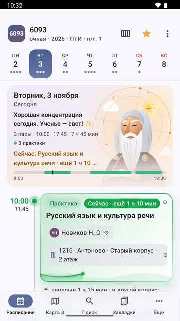 | 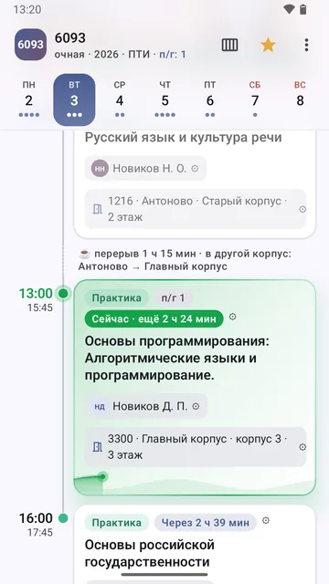 | 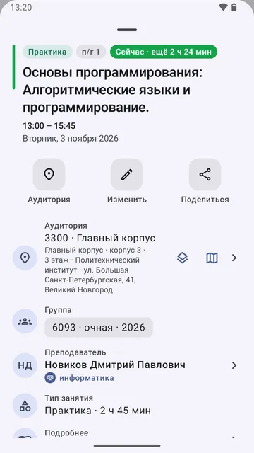 |
| Пара сейчас, здание и этаж | Перерыв: «в другой корпус» | Всё о занятии |
| 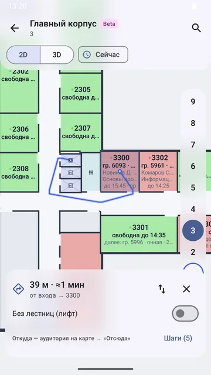 | 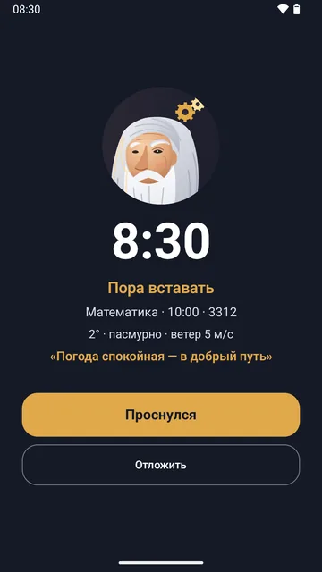 | 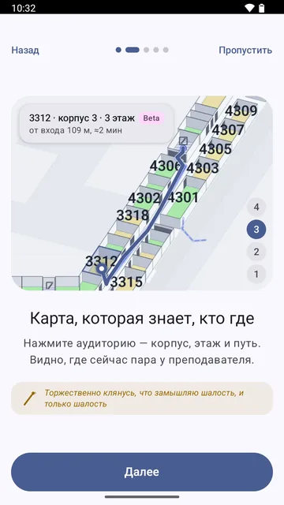 |
| Карта корпуса · Beta: маршрут | «Пора вставать» с погодой | Знакомство при первом запуске |
| 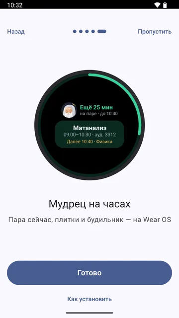 | 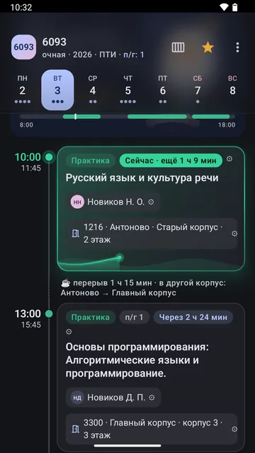 | 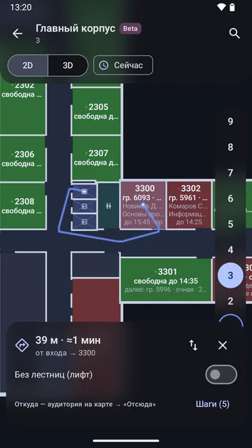 |
| Плитка на часах | Тёмная тема | Карта в тёмной теме |

## В движении

| | |
|:-:|:-:|
| 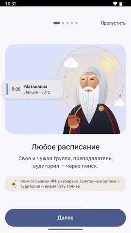 | 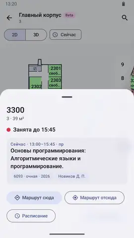 |
| Знакомство: расписание и карта с маршрутом | Маршрут до аудитории: от входа на 3 этаж (Beta) |

Те же ролики в MP4: [знакомство](docs/media/video/onboarding.mp4), [маршрут](docs/media/video/map-route.mp4),
[будильник](docs/media/video/alarm.mp4).

## Прочее

- [Политика конфиденциальности](docs/privacy.md)

<sub>Неофициальное приложение: данные с открытого портала НовГУ, обработанные нашим сервером.</sub>
