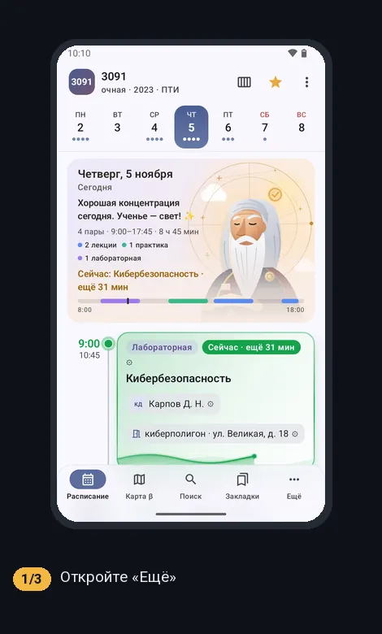
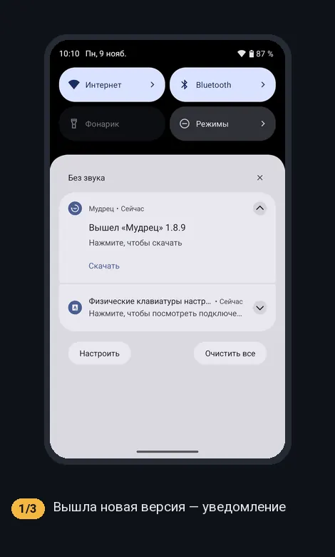
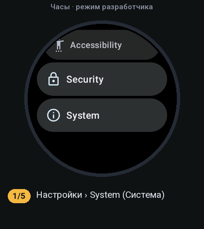
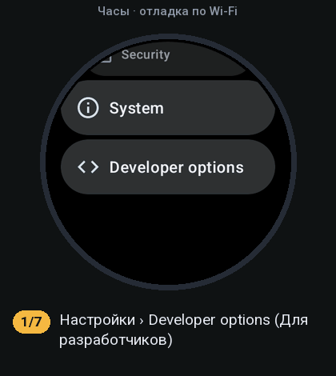
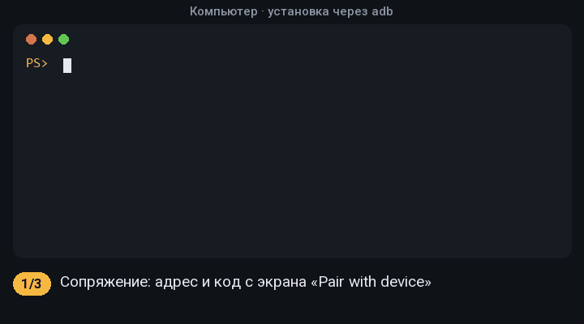

# Приложение «Мудрец» для часов Wear OS

Приложение для часов ставится отдельным файлом
`wiseman-watch-<версия>.apk` из [последнего выпуска](https://github.com/BocmenDen/wiseman-releases/releases/latest).

**Нужно:** часы на Wear OS 3 и новее (Galaxy Watch 4 и новее, Pixel Watch и др.), сопряжённые с телефоном;
на телефоне — «Мудрец». Часы и телефон (или компьютер) — в одной сети Wi-Fi.

Новые версии телефон сам скачивает и отправляет на часы — останется подтвердить на часах; вручную — только первый раз.
Эту инструкцию можно открыть и из приложения: «Ещё › Настройки › Как установить на часы».



Если часы не подключены, новость о версии видна в уведомлении и в «Настройках» › «Часы»:



## 1. Включите режим разработчика на часах

Настройки › Система › Сведения › Версии › 7 раз нажмите «Номер сборки».
На Galaxy Watch: Настройки › О часах › Программное обеспечение › несколько раз нажмите «Версия ПО».



## 2. Включите отладку по Wi-Fi

Настройки › Для разработчиков › включите «Отладка по ADB» и «Отладка по Wi-Fi» › «Подключить новое
устройство». Часы покажут **код** и **адрес с портом** — экран не закрывайте.



## 3. Установите файл на часы

### Без компьютера — рекомендуем

Проще всего с телефона через бесплатное приложение **Wear Installer 2** (Google Play):

1. Скачайте на телефон `wiseman-watch-<версия>.apk` из последнего выпуска.
2. Откройте Wear Installer 2, введите адрес часов, нажмите «Pair» и введите код с часов.
3. Выберите скачанный файл — приложение установит его на часы («Success» в конце).

### С компьютером через adb

Нужен [Android SDK Platform-Tools](https://developer.android.com/tools/releases/platform-tools). Подставьте
свои адрес и код с экрана часов:

```bash
adb pair <адрес:порт для сопряжения> <код>
adb connect <адрес:порт с экрана «Отладка по Wi-Fi»>
adb -s <тот же адрес:порт> install wiseman-watch-<версия>.apk
```



## 4. После установки

Откройте «Мудрец» на часах — расписание «Моё» придёт с телефона. Отладку по Wi-Fi можно выключить.

**Обновление** — те же шаги 2–3 с новым файлом: данные на часах сохранятся.

## Если не получается

- «Failed to connect» — часы и телефон или компьютер в разных сетях, или часы ушли в сон: разбудите их и
  повторите `adb connect`.
- Порт меняется после каждого включения отладки по Wi-Fi — берите адрес с экрана заново.
- «INSTALL_FAILED_UPDATE_INCOMPATIBLE» — на часах стоит версия с другой подписью: удалите её и поставьте заново.
